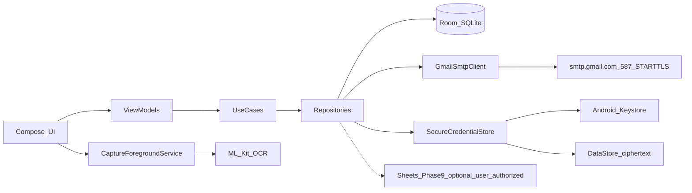
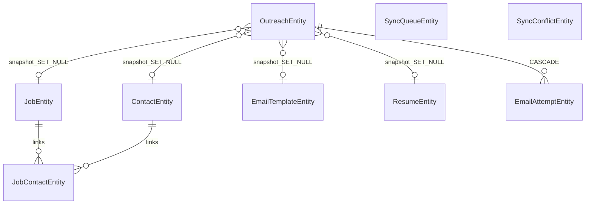

# JobMate – Final Implementation Plan (SMTP-Only)

**Status:** APPROVED for implementation on 2026-10-24 by the product owner.

**Implementation reference:** This file is the approved implementation contract. Future AI sessions must start here, then read `docs/progress/` and the source tree. Do not depend on chat history.

This plan preserves the existing specification pack, layered architecture, Room schema, capture model, and 11-phase sequence. The **only v1 email change** is: Gmail SMTP with App Password authentication. Sheets uses a separate, user-authorized Google Drive scope; this does not change email authentication. Spec files that still said “prefer OAuth2/XOAUTH2” are **overridden for email** by this plan and were patched after approval (see Section 2).

**Explicit confirmations**

- SMTP App Password is the **only** v1 email authentication method.
- OAuth2 / XOAUTH2 is **completely removed from v1 email**.
- Gmail REST API is **not** used.
- **No backend** is required for daily use or sending.
- Previous architecture and **Phases 0–10** are preserved.
- Phase 6 can be implemented **without** an OAuth client ID, web secret, consent screen, or AuthorizationClient.
- No unattended email sending.
- One separate email per recipient.
- Phase 9: create a new `JobMate Sync` spreadsheet with `Jobs` and `Contacts` tabs; use Google account authorization with the `drive.file` scope.

---

## Implementation progress (living)

Update this section after every small step. Do not mark COMPLETE unless implementation and required verification actually finished.

| Field | Value |
| ----- | ----- |
| Overall project status | Core source implementation is recorded through Phase 9. Phase 7 Gemini correction enhancements are source-implemented, but the current tree has no successful full build/CI/device verification. |
| Current phase | Phase 10 – delivery verification |
| Current step | PHASE-10-STEP-58 — make Actions certificate extraction produce a downloadable text file |
| Recorded step reports (implementation status is stated in each report) | Phases 0–2 reports are in `docs/progress/`; Phase 3: [Step 13](docs/progress/PHASE-03-STEP-13.md), [Step 14](docs/progress/PHASE-03-STEP-14.md), [Step 15](docs/progress/PHASE-03-STEP-15.md); Phase 4: [Step 16](docs/progress/PHASE-04-STEP-16.md), [Step 17](docs/progress/PHASE-04-STEP-17.md); Phase 5: [Step 18](docs/progress/PHASE-05-STEP-18.md), [Step 19](docs/progress/PHASE-05-STEP-19.md); Phase 6: [Step 20](docs/progress/PHASE-06-STEP-20.md), [Step 21](docs/progress/PHASE-06-STEP-21.md), [Step 22](docs/progress/PHASE-06-STEP-22.md); Phase 7: Steps [23](docs/progress/PHASE-07-STEP-23.md), [24](docs/progress/PHASE-07-STEP-24.md), [25](docs/progress/PHASE-07-STEP-25.md), [36](docs/progress/PHASE-07-STEP-36.md), [37](docs/progress/PHASE-07-STEP-37.md), [38](docs/progress/PHASE-07-STEP-38.md), [39](docs/progress/PHASE-07-STEP-39.md), [40](docs/progress/PHASE-07-STEP-40.md), [42](docs/progress/PHASE-07-STEP-42.md), [43](docs/progress/PHASE-07-STEP-43.md), [44](docs/progress/PHASE-07-STEP-44.md), [45](docs/progress/PHASE-07-STEP-45.md), [46](docs/progress/PHASE-07-STEP-46.md), [47](docs/progress/PHASE-07-STEP-47.md), [48](docs/progress/PHASE-07-STEP-48.md), [49](docs/progress/PHASE-07-STEP-49.md), [50](docs/progress/PHASE-07-STEP-50.md); Phase 8: [Step 26](docs/progress/PHASE-08-STEP-26.md), [Step 27](docs/progress/PHASE-08-STEP-27.md); Phase 9: [Step 28](docs/progress/PHASE-09-STEP-28.md), [Step 29](docs/progress/PHASE-09-STEP-29.md), [Step 30](docs/progress/PHASE-09-STEP-30.md); Phase 10: Steps [30–35](docs/progress/), [41](docs/progress/PHASE-10-STEP-41.md), [42](docs/progress/PHASE-10-STEP-42.md); [Project audit](docs/progress/PROJECT-AUDIT-2026-10-24.md) |
| In-progress steps | Phase 7 Steps 53–55 change capture job boundaries and add job URL actions. Phase 10 Steps 56–57 add APK certificate details to the Actions artifact and introduce the JobMate launcher/app-bar logo. Step 58 adjusts certificate extraction after the owner’s artifact contained only the APK. |
| Blocked steps | The latest supplied Actions run reached `:app:testDebugUnitTest`: 14 tests completed, 1 failed because `DatabaseRelationsTest.kt:54` expected Room version 2 while `JobMateDatabase` is version 3. Step 52 updates that stale assertion, but CI has not rerun. Steps 53–54 have not been compiled or device-tested. Local compilation remains unavailable because Android SDK (`ANDROID_HOME`/`sdk.dir`) is missing; local Java is 19 rather than pinned JDK 17. No successful full build, lint, test, APK, or device verification is recorded. Sheets live setup still requires API enablement and Android OAuth configuration. |
| Exact next step | Rerun GitHub Actions after Steps 52–56. Download the APK and `app-debug-certificate.txt` from the same artifact, register its SHA-1 for Android OAuth, then install and verify sync and the latest app flows. |
| Approved changes | `compileSdk = 37`, `targetSdk = 36`, `minSdk = 26`; approved dependency/toolchain pins, app architecture, and package remain unchanged. Owner approved on-demand online Gemini Flash-Lite correction using a key entered in the UI; only saved OCR text is sent per correction request. Owner requested reverting rating-row title/company selection to prior fallback behavior. |

Progress reports live in [`docs/progress/`](docs/progress/). One file per small step. Never overwrite an earlier step report to record a different step.

Latest Phase 7 changes: [Step 48 — Gemini manual correction](docs/progress/PHASE-07-STEP-48.md), [Step 49 — revert rating-row title/company anchor](docs/progress/PHASE-07-STEP-49.md), [Step 50 — fix nullable mapping reported by CI](docs/progress/PHASE-07-STEP-50.md), [Step 53 — explicit capture job boundaries](docs/progress/PHASE-07-STEP-53.md), [Step 54 — reliable finish-job boundary](docs/progress/PHASE-07-STEP-54.md), and [Step 55 — actionable job URL](docs/progress/PHASE-07-STEP-55.md). Step 51 records an intermediate CI excerpt; Step 52 updates the stale schema-version assertion and awaits CI confirmation. Earlier Steps 46–47 remain historical records of the previous parser approach and are not overwritten.

Latest delivery changes: [Phase 10 Step 56 — export the APK signer certificate](docs/progress/PHASE-10-STEP-56.md), [Step 57 — add the JobMate logo](docs/progress/PHASE-10-STEP-57.md), and [Step 58 — make certificate export explicit](docs/progress/PHASE-10-STEP-58.md). The owner’s artifact contained only the APK; Step 58 uses the standalone `--print-certs-pem` command and logs a clear error if `apksigner` is missing. The revised workflow has not yet run.

For the current phase-by-phase implementation status and remaining setup/verification work, see [`docs/PROJECT_IMPLEMENTATION_STATUS.md`](docs/PROJECT_IMPLEMENTATION_STATUS.md). This status summary separates source implementation from successful build, test, CI, and device verification.

---

## 1. Application and stack

| Item | Decision |
| ---- | -------- |
| App | JobMate, package `com.saikalyan.jobmate` |
| Platform | Native Android only, Kotlin, Jetpack Compose |
| Architecture | MVVM + Repository; Room is source of truth |
| DI | Hilt only |
| min/compile/target | 26 / 37 / 36 |
| Backend / hosting | None |

**Pinned toolchain** (verify in Phase 0; adjust only if a pin is unpublished or incompatible, then stop and report):

- Kotlin 2.4.21, AGP 9.4.0, Gradle 9.6.0, JDK 17, KSP 2.3.12
- Compose BOM 2026.09.00, Room 2.8.5, Hilt 2.60.1, AndroidX Hilt 1.4.0
- WorkManager 2.12.0, Lifecycle 2.11.0, Navigation 2.10.2, Activity Compose 1.13.0
- Core KTX 1.19.1, Coroutines 1.11.0, DataStore 1.3.0
- ML Kit Text Recognition 16.0.1

**AGP 9 built-in Kotlin (non-negotiable)**

- Do **not** apply `org.jetbrains.kotlin.android` or `kotlin-kapt`.
- Use KSP. Apply `org.jetbrains.kotlin.plugin.compose`.
- Do not disable AGP built-in Kotlin. Java 17.

**Email libraries (proposed; confirm in Phase 0)**

- `com.sun.mail:android-mail:1.6.7`
- `com.sun.mail:android-activation:1.6.7`

If those artifacts fail Android/AGP 9 compatibility, pick another **Android-compatible JavaMail** equivalent. Do **not** substitute Gmail API.

**Do not add for v1 email:** Google AuthorizationClient, Gmail API, Play Services Auth for sending, OAuth client IDs, XOAUTH2 SASL providers, EncryptedSharedPreferences / `security-crypto`.

Phase 9 Google authorization is for Sheets only and is separate from Gmail SMTP authentication. Owner has approved creating a new `JobMate Sync` sheet with `Jobs` and `Contacts` tabs using `drive.file`.

---

## 2. Source of truth vs this revision

Keep folders as they exist (do not treat numbered spec folders as Gradle modules):

- [00-Project](00-Project), [01-Architecture](01-Architecture), [02-Features](02-Features), [03-Data-Model](03-Data-Model), [04-Implementation-Order](04-Implementation-Order), [05-File-Specifications](05-File-Specifications), [06-Code-Skeletons](06-Code-Skeletons) (owner brief said `06-UI-Design`; this repo uses **code skeletons**), [07-Testing](07-Testing), [08-AI-Prompts](08-AI-Prompts)

Create the Android project **at workspace root** with a single Gradle module `:app`. Spec folders stay untouched as product docs except a **minimal email-alignment patch** after approval (below), so implementers are not pulled back to XOAUTH2.

**After approval, patch only email contradictions** (do not rewrite the pack):

- [00-Project/README.md](00-Project/README.md) email bullet
- [01-Architecture/ARCHITECTURE.md](01-Architecture/ARCHITECTURE.md) `data/remote` (SMTP + App Password; Sheets still optional)
- [02-Features/GMAIL_AUTH_AND_SENDING.md](02-Features/GMAIL_AUTH_AND_SENDING.md) rewrite to SMTP-only
- [04-Implementation-Order/BUILD_SEQUENCE.md](04-Implementation-Order/BUILD_SEQUENCE.md) Phase 6 steps 20–21
- [05-File-Specifications/30-GmailSmtpClient.kt.md](05-File-Specifications/30-GmailSmtpClient.kt.md) and [06-Code-Skeletons/GmailSmtpClient.kt.md](06-Code-Skeletons/GmailSmtpClient.kt.md)
- [07-Testing/TEST_PLAN.md](07-Testing/TEST_PLAN.md) integration line (App Password, not OAuth token expiry)

Phase 9 item 28 uses Google Identity authorization for the Sheets API only. It is **not** Gmail send authentication.

[05-File-Specifications/FILE_INDEX.md](05-File-Specifications/FILE_INDEX.md) already allows extra files; add credential store, Gmail settings, remaining DAOs/entities, follow-up/settings UI, import parsers, and CI as needed. Do not cram them into `GmailSmtpClient`.

---

## 3. Architecture (updated)



Layers under `com.saikalyan.jobmate`:

- `data/local` — Room entities, DAOs, converters, database
- `data/remote` — `GmailSmtpClient` only for mail; **no OAuth client**
- `data/secure` — Keystore AES-256-GCM + DataStore ciphertext (interface in domain)
- `data/repository` — implementations returning domain models
- `domain/model`, `domain/repository`, `domain/usecase`
- `ui` — Compose, navigation, theme
- `service` — MediaProjection FGS
- `worker` — WorkManager **Sheets only** (Phase 9); **never** unattended SMTP
- `di` — Hilt
- `util` — validation, dispatchers, redacted logging, typed results

Rules from [01-Architecture/ARCHITECTURE.md](01-Architecture/ARCHITECTURE.md) stay: StateFlow UI; no SQL/SMTP/OCR/network in Composables; transactions; inject dispatchers/clock; never log credentials, tokens, full bodies, resume paths, or screenshots.

---

## 4. Project folder structure

```
JobMate-Development-Spec/
  JOBMATE_IMPLEMENTATION_PLAN.md   # approved implementation contract
  docs/progress/                   # one Markdown report per small step
  00-Project/ … 08-AI-Prompts/     # spec pack, not Gradle modules
  settings.gradle.kts              # root name JobMate; include :app; FAIL_ON_PROJECT_REPOS
  build.gradle.kts
  gradle/libs.versions.toml
  gradle/wrapper/                  # committed
  app/build.gradle.kts
  app/src/main/AndroidManifest.xml
  app/src/main/java/com/saikalyan/jobmate/...
  app/src/main/res/
  app/schemas/                     # Room schema export
  app/src/test/  app/src/androidTest/
  .github/workflows/android-ci.yml
```

`settings.gradle.kts`: Google, Maven Central, Plugin Portal; **only** `:app`.

---

## 5. Final Gradle dependency list

Version catalog aliases covering:

- Android application plugin, Compose compiler plugin, Hilt, KSP, Room
- Compose BOM + UI, Material3, tooling, activity-compose, navigation-compose, lifecycle-runtime-compose / viewmodel-compose
- Room runtime/ktx/compiler (KSP), Hilt Android + compiler + `hilt-navigation-compose` + `hilt-work` if Sheets worker needs it later
- Coroutines, DataStore Preferences (or proto) for encrypted blob metadata
- WorkManager (present from catalog; used in Phase 9)
- ML Kit text recognition
- Google Play services authorization (`play-services-auth` 21.6.0) for Phase 9 Sheets only; never used for Gmail sending
- Proposed JavaMail Android artifacts (Phase 0 confirm)
- Test: JUnit, coroutines-test, Room testing, Turbine or similar, Compose UI test, Hilt testing, MockK or equivalent already common in Android

**Not in v1:** Apache POI, Gmail API client, Google Auth library for SMTP, `androidx.security:security-crypto`.

When adding JavaMail, exclude duplicate `META-INF/NOTICE.md` and `META-INF/LICENSE.md` from packaging if the build requires it (known Android packaging issue with `android-mail` 1.6.x). Do not treat this as Gmail API substitution.

Manifest (from [05-File-Specifications/05-AndroidManifest.xml.md](05-File-Specifications/05-AndroidManifest.xml.md) plus SMTP/capture): `INTERNET`; POST_NOTIFICATIONS as required; FGS `mediaProjection` type; non-exported capture service; exported launcher; SAF not broad storage; no AccessibilityService; exclude credential DataStore from backup (`fullBackupContent` / data-extraction rules; do not back up App Password ciphertext).

---

## 6. Database ER summary

Preserve [03-Data-Model/ROOM_SCHEMA.md](03-Data-Model/ROOM_SCHEMA.md). UUID string PKs, timestamps, indexes, schema export, **explicit migrations, no destructive production migration**. Never store passwords, App Passwords, PDF bytes, or screenshots in Room.

**Entities:** Job, Contact, JobContact, Resume, EmailTemplate, Outreach, EmailAttempt, SyncQueue, SyncConflict.

**Job statuses (existing):** SAVED, APPLIED, INTERVIEW, OFFER, REJECTED, WITHDRAWN, **CLOSED = archive**.

**Outreach history (owner revision, keep):** Outreach FKs to Job, Contact, Template, Resume are **nullable + ON DELETE SET NULL**. Store snapshots on `OutreachEntity`: recipient name/email, job title, company name, template name, resume display name. `EmailAttemptEntity` CASCADE from Outreach. `JobContactEntity` CASCADE as a junction. Deleting a job or contact **must not** erase outreach history.



Contact unique **normalized email** unless owner later changes policy.

---

## 7. Screens and navigation

From [05-File-Specifications/08-AppNavHost.kt.md](05-File-Specifications/08-AppNavHost.kt.md), plus Gmail SMTP settings:

- Dashboard (stats from Room only; quick actions: Add Job, Capture Job, Import Contacts, Add Resume, Compose Email)
- Jobs list (search, status filter) / Job editor / Job detail
- Contacts / CSV-XLSX import / match review
- Resumes
- Outreach composer / preview / confirm / history
- Follow-ups (upcoming, overdue, mark complete)
- Settings: Gmail SMTP, theme, notifications, Google Sheets sync, export, delete local data, app info
- Gmail configuration (can be a Settings child route)
- Capture explanation + Capture review
- Sharesheet `ACTION_SEND` `text/plain` fallback into job editor

Pass IDs only; never pass App Password or MIME content through nav args.

Dashboard counts: total jobs, applied, interested companies, contacts, emails sent, follow-ups due, overdue, recent jobs.

---

## 8. Feature requirements (unchanged except email auth)

**Jobs:** manual CRUD, archive via CLOSED, URL, description, location, applied date, notes, follow-up date.

**Contacts:** CRUD; CSV RFC4180; XLSX via ZipFile + XmlPullParser (`sharedStrings.xml`, worksheet XML, inline strings, numeric cells); reject legacy **XLS** with a clear message; no Apache POI; max **2,000 rows**; validate/normalize email; duplicate detection; company match suggestions; **manual review**; never auto-send after import.

**Resumes:** multiple PDFs, app-private storage, validate PDF, max **10 MB**, display names, select on compose, delete; never upload to Sheets.

**Templates:** seed Referral Request and Open for Opportunities; placeholders at least contact/first name, company, job title, sender name; keep existing spec extras `{{jobUrl}}` and block send on unresolved placeholders; local edit/save.

**Outreach:** job + contact + template + resume; preview; edit subject/body; confirm; one MIME / one To; no CC/BCC; no auto send; no auto follow-up email; persist SENT / FAILED / UNKNOWN; **never auto-retry UNKNOWN**.

**Follow-ups:** dates, upcoming/overdue, complete, local notifications, dashboard; no auto email in v1.

**Capture:** user-consented MediaProjection + on-device ML Kit; explanation; notification permission if required; FGS `mediaProjection`; user switches apps and **manually** scrolls; a permission-gated draggable camera/checkmark overlay remains visible over apps. Camera captures each visible page and automatically saves/appends it to the active job. Checkmark finishes the current job; the next camera capture starts a new job. The camera control indicates OCR/save status. The ongoing notification remains for the foreground service and Stop action; it is not the external-app capture control. Preserve recognized text and let the user correct details later from Jobs. No per-capture review/confirm step. No AccessibilityService, auto-click/scroll, hidden capture, FLAG_SECURE bypass, background collection, or screenshot upload. Discard bitmaps after OCR. Honor Android 14+ **single-use** MediaProjection: recapture requires a new system consent; do not reuse a consumed token. Sources: Naukri, LinkedIn, other sites, manual entry, Sharesheet.

**Sheets:** optional, owner-approved new sheet and Google authorization. WorkManager syncs structured jobs/contacts only. Never sync App Passwords, credentials, outreach drafts, PDFs, or screenshots.

---

## 9. Phase 6 – SMTP-only (detailed)

Replace BUILD_SEQUENCE steps 20–21 with:

20. Gmail settings UI + App Password + Keystore-backed credential repository
21. SMTP STARTTLS send client (no XOAUTH2)
22. Per-recipient attempts, UNKNOWN handling, history (unchanged intent)

**Settings UI**

- Gmail address; field labeled **Gmail App Password** (not Gmail Password); masked input; Save; Test connection; status; Disconnect.
- Copy: user must create an App Password in Google Account settings. **Do not promise** every account can do this (personal 2SV eligibility, Workspace admin policy).
- Map SMTP auth failures to a useful ineligible/rejected-auth message.

**Secure storage**

- Never store a normal Gmail password. Never Room. Never source/git.
- Android Keystore key; AES-256-GCM; ciphertext in DataStore (or equivalent local file excluded from backup).
- Repository interface; clear ciphertext + related keys on Disconnect.
- Missing/invalidated Keystore key or corrupt blob → reconnect prompt, no crash loop.
- No credential logs.

**SMTP**

- Host `smtp.gmail.com`, port **587**, STARTTLS, certificate validation, timeouts, App Password AUTH.
- MIME + optional PDF attachment; exactly one recipient.
- Test connection **without** sending mail (connect + auth + quit).
- Map errors: bad password, ineligible/auth rejected, network, TLS, invalid recipient, timeout after possible submit → UNKNOWN.

**Send workflow**

1. Composer selections → preview → user confirms
2. One MIME → SMTP send → persist Outreach + EmailAttempt
3. User views history
4. No WorkManager send; no silent retry of UNKNOWN

**Phase 6 tests**

Valid/invalid App Password; ineligible-account messaging; connection failure; STARTTLS path; successful send; invalid recipient; PDF attachment; N recipients = N messages; disconnect wipes credentials; restart recovers ciphertext when Keystore key still valid. **No OAuth client ID required.**

---

## 10. GitHub Actions

File: `.github/workflows/android-ci.yml`

- Triggers: `push`, `pull_request`, `workflow_dispatch`
- `ubuntu-latest`, JDK 17, Android SDK cmdline tools, Gradle wrapper
- Checkout → Java 17 → SDK + licenses + Platform 37 / Build Tools 37.0.0 / platform-tools / command-line tools →
  `./gradlew --no-daemon --stacktrace :app:testDebugUnitTest :app:lintDebug :app:assembleDebug`
- Upload `app/build/outputs/apk/debug/app-debug.apk`
- No Gmail credentials, signing secrets, or OAuth secrets in GitHub

### Build versioning (SemVer)

- Root `VERSION` stores the release line in strict `MAJOR.MINOR.PATCH` form. Bump **PATCH** for backward-compatible fixes, **MINOR** for backward-compatible features, and **MAJOR** for incompatible changes.
- Each CI APK uses valid SemVer build metadata: `<VERSION>+ci.<run_number>.<run_attempt>`. Each local Gradle build uses `<VERSION>+local.<epoch_milliseconds>`.
- CI Android `versionCode` is `1,000,000 + (run_number × 1,000) + run_attempt`, so retries and later workflow runs receive increasing install codes. Attempts must stay below 1,000 and codes must remain within Android's supported limit.
- The CI artifact name includes the full SemVer build identifier. Build metadata distinguishes artifacts but does not change SemVer precedence; the release version remains the MAJOR.MINOR.PATCH value in `VERSION`.

Owner does not need a local Android Studio/SDK for routine CI builds; device testing in Phase 10 still needs a real phone.

---

## 11. Phase-by-phase checklist

Implement **one phase at a time**. After each: compile, run relevant tests, fix, verify real behavior, then next. No empty placeholder screens as “done”.

**Phase 0 – Foundation**
Wrapper, version catalog, `:app`, Manifest, `JobMateApplication` + Hilt, Compose theme, nav shell, CI, first debug APK. Confirm JavaMail + AGP 9 Kotlin rules.

**Phase 1 – Domain and database**
Models, all 9 entities (outreach SET NULL + snapshots), DAOs, DB, repositories, Hilt, DAO tests, migrations.

**Phase 2 – Dashboard and jobs**
Room-backed dashboard, job CRUD/search/status/detail.

**Phase 3 – Contacts**
CRUD, CSV, native XLSX, validation, duplicates, matching, review.

**Phase 4 – Resumes**
PDF import, private storage, list, selection, delete, 10 MB/PDF checks.

**Phase 5 – Templates and outreach**
Template CRUD, renderer, composer, preview, confirm (send wired in Phase 6).

**Phase 6 – Gmail SMTP**
As section 9.

**Phase 7 – Job capture**
MediaProjection FGS, ImageReader, ML Kit, parser, review, Sharesheet; Android 14+ single-use.

**Phase 8 – Follow-ups and settings**
Follow-ups, notifications, theme, export, delete data, Gmail settings already from Phase 6.

**Phase 9 – Google Sheets**
Owner approved creating a new `JobMate Sync` spreadsheet with `Jobs` and `Contacts` tabs using Google authorization and `drive.file`. Sync structured job/contact fields only via WorkManager, durable queue, tombstones, and conflict review. Never sync credentials, outreach, resumes, or screenshots. Enable Sheets API and configure an Android OAuth client using package `com.saikalyan.jobmate` and the signing certificate SHA-1 before live account verification.

**Phase 10 – Delivery**
Unit/repository/UI tests as practical, lint, privacy review, real device, CI green, APK.

AI workflow: [08-AI-Prompts/FILE_BY_FILE_PROMPT.md](08-AI-Prompts/FILE_BY_FILE_PROMPT.md) and [08-AI-Prompts/PHASE_REVIEW_PROMPT.md](08-AI-Prompts/PHASE_REVIEW_PROMPT.md), with email rules from this plan not the old XOAUTH2 skeleton.

---

## 12. Testing strategy

Preserve [07-Testing/TEST_PLAN.md](07-Testing/TEST_PLAN.md) with email integration rewritten:

- **Unit:** validation, matcher, CSV/XLSX, placeholders, OCR fixtures, MIME one-recipient, redacted errors, credential wipe/corrupt handling (fake Keystore in JVM where possible)
- **Room:** CRUD, FKs SET NULL vs CASCADE, dashboard counts, migrations
- **SMTP:** Phase 6 list on a dedicated Gmail test account with App Password; no OAuth
- **UI:** dashboard, jobs, import, resumes, per-recipient confirm, capture review, Gmail connect/disconnect/delete
- **Device:** API 26 + current; dark mode; font scale; offline; denied MediaProjection
- **Privacy gate:** no normal password; no secrets in logs/Room/backup/Sheets/GitHub; no resume upload; no stealth capture; TLS; no auto-retry UNKNOWN

---

## 13. Remaining risks and unresolved decisions

**Risks (accepted)**

- App Passwords are **not universal** (no 2SV, Workspace admin off, Google policy change).
- SMTP UNKNOWN can still duplicate if the user manually retries after a drop.
- JavaMail 1.6.7 is older; Phase 0 may need a maintained Android Mail artifact.
- MediaProjection single-use, FLAG_SECURE blanks, OCR errors, job-site UI drift.
- Unique contact email may reject legitimate shared inboxes.
- Android OAuth client/SHA-1 and Google Sheets API enablement are required for live Phase 9 verification; this identity scope is separate from Phase 6 Gmail SMTP.

**Unresolved (ask owner when that phase starts; do not invent)**

- Whether contact unique-email policy should be relaxed.
- Release signing (CI is debug APK only; no secrets in repo).
- Exact JavaMail coordinates if 1.6.7 fails Phase 0.

**Not unresolved**

- Email auth = App Password SMTP only. No OAuth for sending in v1.

---

## 14. Documentation workflow (mandatory)

This workflow is required for every subsequent implementation step. A future Cursor or ChatGPT session with **no** access to prior chat must be able to continue from this file and `docs/progress/`.

### 14.1 Progress reports

Directory: [`docs/progress/`](docs/progress/)

Naming:

- `PHASE-00-STEP-01.md`
- `PHASE-00-STEP-02.md`
- `PHASE-01-STEP-01.md`

Continue this convention for all phases.

Each completed small implementation step must have its own new Markdown file. Do not combine multiple completed steps into one report. Never overwrite an earlier step report to record a different step.

Each report must include:

- Phase and step number
- Step title
- Completion date
- Objective
- Implementation summary
- Files created
- Files modified
- Dependencies added or changed
- Database/schema changes, if applicable
- Important technical decisions
- Tests actually executed
- Build results
- Errors encountered and how they were resolved
- Known issues or pending work
- Exact next implementation step

Status values: `IN PROGRESS`, `COMPLETE`, `BLOCKED`. Never mark COMPLETE unless implementation and required verification actually finished. If blocked, document the reason in that step’s report.

### 14.2 Master plan updates

After every small step, update the **Implementation progress (living)** section of this file:

- Overall project status
- Current phase
- Completed steps (with relative paths to reports)
- In-progress steps
- Blocked steps
- Exact next step
- Approved changes, if any

### 14.3 Small-step policy

Do not implement an entire phase in one enormous change. Break each phase into small, independently verifiable steps. After completing each step, stop, write the progress report, update this file, and report results. Do not silently continue through several steps without documentation.

### 14.4 GitHub continuity

The GitHub repository must contain:

- This approved implementation plan
- All original specification documents
- All implementation progress reports
- All application source code
- GitHub Actions configuration

After each small step, list changed files and provide Git commands to commit and push. Do not claim a push succeeded unless it actually succeeded. Do not commit secrets.

### 14.5 Session start protocol (for a new AI)

1. Read `JOBMATE_IMPLEMENTATION_PLAN.md` (this file), especially progress, stack, SMTP-only rules, and the current phase step list.
2. Read every report in `docs/progress/`, newest last.
3. Inspect the source tree and spec pack.
4. Continue from the **Exact next step**. Do not re-do COMPLETE steps. Do not skip BLOCKED steps without resolving the block.

---

## 15. Phase 0 small-step breakdown

Phase 0 step tracking for the root Android project and its single `:app` module.

| Step | Title | Verification |
| ---- | ----- | ------------ |
| PHASE-00-STEP-01 | Verify toolchain and dependencies | Artifact existence, AGP 9 Kotlin rules, JavaMail coordinates; no Gradle module yet |
| PHASE-00-STEP-02 | Create Gradle wrapper, root Gradle files, and version catalog | `settings.gradle.kts`, root `build.gradle.kts`, `gradle/libs.versions.toml`, wrapper files; `:app` not fully wired yet if catalog-first |
| PHASE-00-STEP-03 | Create the `:app` module | `app/build.gradle.kts`, namespace `com.saikalyan.jobmate`, minSdk 26, compileSdk 37, targetSdk 36, Compose, Hilt, KSP, Java 17; AGP 9 Kotlin rules |
| PHASE-00-STEP-04 | Configure Android Manifest | Internet, launcher, no AccessibilityService, placeholder-safe permissions for later FGS |
| PHASE-00-STEP-05 | Set up Hilt Application and MainActivity | `@HiltAndroidApp`, Compose `setContent` |
| PHASE-00-STEP-06 | Set up Compose theme and navigation shell | Material 3 theme, `AppNavHost` destinations without fake completed features |
| PHASE-00-STEP-07 | Configure GitHub Actions | `.github/workflows/android-ci.yml` as Section 10 |
| PHASE-00-STEP-08 | Run initial build and verify debug APK | `./gradlew --no-daemon --stacktrace :app:testDebugUnitTest :app:lintDebug :app:assembleDebug` and APK path |

Do not declare Phase 0 complete until STEP 08 verification succeeds.

Later phases will be broken into similarly small steps when that phase starts.

---

## 16. Approval closeout

Owner approved this plan on 2026-10-24.

After approval the required first actions are:

1. Save this file at the repository root.
2. Create `docs/progress/`.
3. Apply the Section 2 email-alignment patches.
4. Execute PHASE-00-STEP-01 only, then stop and document.
